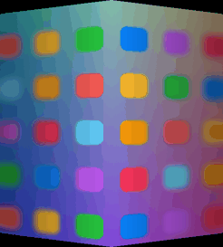
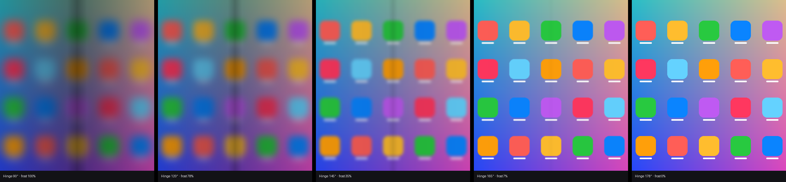

# siphoneFold — Frost Fold

An iPhone Duo–style **frosted-glass fold animation** for the Samsung Galaxy Z Fold 7 (and other book-style Android foldables), driven live by the phone's real hinge-angle sensor.

As you open the phone the screen goes out of focus, as if you were looking at it through a tilted pane of frosted glass. It stays soft through most of the unfold, then settles smoothly into sharp focus just before the phone lies flat. Closing plays it in reverse.

- **No root, no Shizuku, no accessibility service.** It's a normal app that uses public Android APIs only.
- **Written from scratch.** It's plain Java with no third-party libraries, and it builds straight from the Android SDK with no Gradle.
- **Doesn't block the phone.** You can tap through the glass, and it fades on its own if you stop moving the hinge, so Flex mode is never covered.



---

## How it looks

These frames show the inner screen at different hinge angles. *0° is closed and 180° is flat.*



| Hinge | Frost | What you see |
|---|---|---|
| 90° | 100% | Fully blurred and dimmed. Each half is shaded towards the crease. |
| 120° | 78% | Still soft. The crease shadow narrows as the panels come flat. |
| 145° | 35% | Content starts to resolve. |
| 165° | 7% | Almost sharp. |
| 178° | 0% | Clear. The overlay window is removed completely. |

> The images above are generated by [`tools/render_preview.py`](tools/render_preview.py). It runs the same drawing and timing maths as the app on a stand-in home screen, so you can see the effect without a phone. On a real device, Android's window blur behaves slightly differently from the Gaussian blur used here.

---

## What happens during a fold

```
 closed ─────────────── opening ───────────────────────────── flat
 0°        30°                   95°                         178° 180°
 │ cover screen frosts │ (inner screen turns on) │ inner screen clears │
 │ as you start to     │                         │ frosted → sharp,    │
 │ open the phone      │   inner screen fully    │ easing into focus   │
 │                     │   frosted               │                     │
```

1. **Cover screen (0–30°):** As you start opening, the outer screen fogs up, the same way the iPhone Duo's outer image loses definition.
2. **Inner screen (95–178°):** When Samsung switches to the inner panel, it continues the same blur, so the two screens feel like one continuous surface. The frost amount follows a *smoothstep* curve, so the glass stays soft for longest and then settles gently into focus.
3. **Spring motion:** The visible frost follows the hinge through a critically damped spring (stiffness 380). That smooths out sensor jitter and gives an iOS-like settle with no overshoot.
4. **Rest timeout:** If the hinge doesn't move for 700 ms, the glass fades out, so a half-open phone (Flex mode, propped on a table) is never covered.

---

## How it works

```
┌────────────────────┐   hinge angle (TYPE_HINGE_ANGLE, ~every few ms)
│  Hinge sensor      │──────────────────────────────┐
└────────────────────┘                              ▼
                                   ┌──────────────────────────────────┐
                                   │ FrostService (foreground service) │
                                   │  • angle → target frost (0..1)    │
                                   │  • spring → current frost         │
                                   │  • Choreographer, every frame     │
                                   └───────────────┬──────────────────┘
                                                   │
                      ┌────────────────────────────┴───────────────────────┐
                      ▼                                                    ▼
      Window blur behind the overlay                       FrostView (drawn on top)
      FLAG_BLUR_BEHIND, radius = strength × frost          • even dim
      (done by SurfaceFlinger, GPU)                        • per-half tilt shading
                                                           • soft crease shadow
```

| File | Role |
|---|---|
| [`FrostService.java`](src/com/rameshinampudi/frostfold/FrostService.java) | Listens to the hinge sensor and turns the angle into a frost amount (cover and inner curves). Runs the spring animation on `Choreographer` and adds or removes the overlay window, updating its blur radius every frame. |
| [`FrostView.java`](src/com/rameshinampudi/frostfold/FrostView.java) | Draws the glass: dim, per-half shading towards the hinge, and the crease shadow. Works in portrait and landscape: the hinge is vertical when the screen is taller than it is wide. |
| [`MainActivity.java`](src/com/rameshinampudi/frostfold/MainActivity.java) | Settings screen: on/off switch, frost strength, "also when closing", a live hinge-angle readout and a **Preview** button. |
| [`BootReceiver.java`](src/com/rameshinampudi/frostfold/BootReceiver.java) | Restarts the effect after a reboot, if it was switched on. |
| [`AndroidManifest.xml`](AndroidManifest.xml) | Permissions and components. |
| [`build.sh`](build.sh) | Builds and signs the APK straight from the Android SDK. |
| [`tools/render_preview.py`](tools/render_preview.py) | Renders the reference images in `docs/images/`. |

### Key details
- **Which screen is showing:** On the Fold 7, Android's main display (display 0) moves between the cover panel (1080×2520, tall) and the inner panel (1968×2184, nearly square). The service uses a *window context* bound to display 0, so it follows the switch. It reads the aspect ratio to tell which panel is active.
- **Tapping through the overlay:** The overlay is `FLAG_NOT_TOUCHABLE` and `FLAG_NOT_FOCUSABLE`, and its opacity is capped at `InputManager.getMaximumObscuringOpacityForTouch()` (0.8). Above that, Android 12+ would block touches to the app underneath.
- **No cost when idle:** The overlay window only exists during a fold. When the frost reaches zero it's removed and the frame loop stops. The only thing left running is the sensor listener in a low-priority foreground service.
- **Blur fallback:** If cross-window blur is unavailable (some power-saving modes turn it off), the effect still shows the dim and shading, just without blur.

---

## Requirements

- An Android foldable with a hinge-angle sensor running **Android 12 (API 31) or newer**. Tested on a Galaxy Z Fold 7 (SM-F966B, Android 17 / One UI 9).
- To build: **JDK 17+** and the **Android SDK** with `platforms;android-36` and `build-tools;36.0.0`. The script expects them in `~/Library/Android/sdk`.

## Build

```bash
git clone https://github.com/ikppramesh/siphoneFold.git
cd siphoneFold
./build.sh            # → build/FrostFold.apk
```

`build.sh` runs `aapt2` (resources) → `javac` → `d8` (dex) → `zipalign` → `apksigner`, signing with your Android debug key (`~/.android/debug.keystore`). If your SDK is elsewhere, edit `SDK=` at the top of the script.

## Install on the phone

**Over Wi-Fi with ADB:**
1. On the phone: **Settings → About phone → Software information**, tap **Build number** 7 times.
2. **Settings → Developer options → Wireless debugging** → on → **Pair device with pairing code**.
3. On the computer:
   ```bash
   adb pair <ip>:<pairing-port> <code>
   adb connect <ip>:<port>          # often automatic after pairing
   adb install -r build/FrostFold.apk
   # optional: grant the overlay permission without going through Settings
   adb shell appops set com.rameshinampudi.frostfold SYSTEM_ALERT_WINDOW allow
   ```

**Or** copy `build/FrostFold.apk` to the phone and open it to install. You'll need to allow installs from that source.

## Use

1. Open **Frost Fold**.
2. If asked, tap **Allow display over other apps** and switch it on.
3. Turn on **Fold animation**.
4. Tap **Preview animation** to see a simulated unfold, then try it for real: close the phone and open it slowly.

| Setting | Default | What it does |
|---|---|---|
| Fold animation | off | Starts or stops the background service. |
| Also when closing | on | Plays the effect in reverse when you close the phone. |
| Frost strength | 110 | Maximum blur radius in pixels (0–200). |

While it's on, Android shows a small, silent "Frost Fold is on" notification. Android requires this for any app that keeps listening to a sensor in the background.

## Tuning

All the feel parameters are constants at the top of `FrostService.java`:

| Constant | Default | Effect |
|---|---|---|
| `INNER_FROST_ANGLE` | 95° | At or below this angle, the inner screen is fully frosted. |
| `INNER_CLEAR_ANGLE` | 178° | The angle where the inner screen is fully sharp. |
| `COVER_FROST_ANGLE` | 30° | How far you open before the cover screen is fully frosted. |
| `SPRING_STIFFNESS` | 380 | Higher means it follows the hinge more tightly; lower means softer and floatier. |
| `REST_MS` | 700 ms | How long the hinge must be still before the glass fades away. |
| `PREVIEW_MS` | 1400 ms | Length of the in-app preview. |

Glass colour, dim and shading strengths are in `FrostView.onDraw`. After changing anything, run `./build.sh && adb install -r build/FrostFold.apk`, then regenerate the images with `python3 tools/render_preview.py` (needs `numpy` and `Pillow`).

## Limitations

- **The content behind the glass isn't bent in 3D.** Android doesn't let one app reshape another app's pixels. The tilt comes from per-half shading, not real perspective.
- **The status bar and navigation bar sit above app overlays**, so they stay sharp during the fold.
- **Samsung's own unfold transition still plays underneath.** Frost Fold adds to it; it doesn't replace it, because that needs system (root) access.
- **Battery saver may turn off window blur.** The effect then falls back to dim and shading only.

## Uninstall

Turn off **Fold animation** in the app, then uninstall it as usual, or run `adb uninstall com.rameshinampudi.frostfold`.

## Licence

MIT. Do what you like with it.
